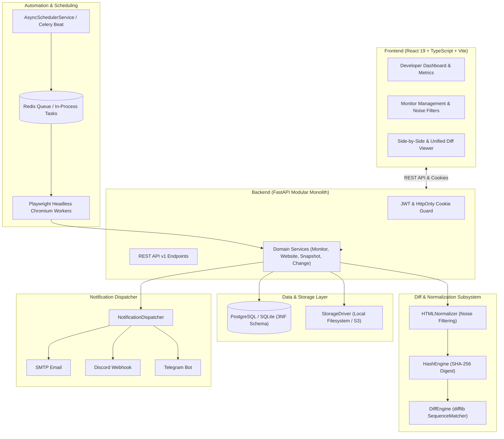

# Website Change Detection Platform

> A production-quality, developer-first website change detection and visual diff monitoring platform built as a clean Modular Monolith. Inspired by professional engineering tools like Better Stack, Datadog, Grafana, and Linear.

---

## 🌟 Key Features

- **Real Browser Rendering (Playwright):** Automates headless Chromium to execute client-side JavaScript, wait for network idle or DOMContentLoaded, and capture authentic Single Page Application (SPA) DOM state.
- **Full-Page Visual Snapshots:** Captures high-resolution PNG screenshots alongside serialized HTML for side-by-side visual and DOM change inspection.
- **Intelligent Noise Filtering:**
  - Strips scripts, styles, iframes, SVGs, and tracking pixels.
  - Automatically decomposes cookie banners, GDPR consent modals, and ads.
  - Normalizes dynamic volatile content (timestamps, session tokens, live visitor counters) to static placeholders.
  - Supports custom user-defined **CSS selectors** and **DOM ignored regions**.
- **Deterministic Snapshot Lifecycle:** Computes SHA-256 hashes of normalized content. **Snapshots are only persisted when meaningful content changes occur**, preventing storage bloat.
- **Developer Diff Engine:** Computes exact line additions, removals, modifications, mutation percentages, and structured side-by-side comparison chunks (`difflib.SequenceMatcher`).
- **Multi-Channel Alert Dispatcher:** Concurrently delivers formatted change alerts to:
  - **SMTP Email** (Responsive HTML + plain text)
  - **Discord Webhooks** (Rich color-coded embed cards)
  - **Telegram Bot** (Structured Markdown messages)
- **Developer-Grade Interface:** Monochromatic, high-density, keyboard-friendly UI with zero generic AI gradients or marketing bloat. Built with React 19, Vite, Tailwind CSS v4, Lucide Icons, and Recharts.
- **Dual Execution Engine:**
  - **Production:** Distributed Celery workers + Redis + PostgreSQL + S3 storage.
  - **Local Development:** Zero-dependency standalone execution with SQLite and in-process AsyncScheduler.

---

## 🏗️ Architecture



---

## 🛠️ Tech Stack

### Frontend
- **React 19**
- **TypeScript**
- **Vite**
- **Tailwind CSS v4**
- **TanStack Query v5**
- **Lucide Icons**
- **Recharts**

### Backend
- **Python 3.13**
- **FastAPI**
- **SQLAlchemy 2.0 (Async)**
- **Alembic**
- **Pydantic v2**
- **PostgreSQL / SQLite**
- **Playwright (Chromium)**
- **Celery 5.4 & Redis**

---

## 🚀 Quick Start Guide

### Option 1: Local Development (Zero External Dependencies)

#### 1. Backend Setup
```bash
cd backend

# Create and activate virtual environment
python -m venv venv
# On Windows:
.\venv\Scripts\Activate.ps1
# On macOS/Linux:
source venv/bin/activate

# Install dependencies and Playwright Chromium
pip install -r requirements.txt
playwright install chromium

# Start FastAPI server (Database initializes automatically with AsyncScheduler)
uvicorn app.main:app --host 127.0.0.1 --port 8000 --reload
```
API runs at: `http://127.0.0.1:8000`
API Docs at: `http://127.0.0.1:8000/docs`

#### 2. Frontend Setup
```bash
cd frontend

# Install npm packages
npm install

# Start Vite development server
npm run dev
```
Dashboard runs at: `http://localhost:5173`

---

### Option 2: Docker Compose (Production Environment)

Run the entire distributed stack (PostgreSQL, Redis, FastAPI, Celery Worker, and Celery Beat):

```bash
cd backend
docker compose up -d --build
```

---

## 🧪 Running Automated Tests

The backend includes comprehensive test coverage for diff calculations, noise normalization, authentication, and API endpoints:

```bash
cd backend
pytest -v
```

---

## 📚 Documentation Index

Detailed architectural deep dives, database schema documentation, and file-by-file code explanations are maintained in the [`docs/`](file:///d:/pro_1/docs) folder:

### System & Architecture Documents
- [Architecture.md](file:///d:/pro_1/docs/Architecture.md) — System design, modular monolith pattern, sequence diagrams, and design trade-offs.
- [Database.md](file:///d:/pro_1/docs/Database.md) — 3NF normalized schema, ER diagram, indexing strategy, and relationships.
- [API.md](file:///d:/pro_1/docs/API.md) — RESTful API endpoints, request/response models, and auth mechanisms.
- [Workflow.md](file:///d:/pro_1/docs/Workflow.md) — Snapshot lifecycle state machine and end-to-end check pipeline.
- [Scheduler.md](file:///d:/pro_1/docs/Scheduler.md) — Periodic interval checking, Celery Beat, and In-Process AsyncScheduler.
- [Playwright.md](file:///d:/pro_1/docs/Playwright.md) — Headless Chromium automation, network idle synchronization, and screenshot capture.
- [DiffEngine.md](file:///d:/pro_1/docs/DiffEngine.md) — DOM sanitization, dynamic noise filters, SHA-256 hashing, and line diffing.
- [Storage.md](file:///d:/pro_1/docs/Storage.md) — StorageDriver abstraction, path traversal security, and S3 migration guide.
- [Authentication.md](file:///d:/pro_1/docs/Authentication.md) — JWT issuance, HttpOnly cookies, and Refresh Token Rotation.
- [Notifications.md](file:///d:/pro_1/docs/Notifications.md) — Dispatcher architecture for Email, Discord webhooks, and Telegram bots.
- [Deployment.md](file:///d:/pro_1/docs/Deployment.md) — Production deployment with Docker Compose, Railway, Vercel, and Cloud VPS.
- [FolderStructure.md](file:///d:/pro_1/docs/FolderStructure.md) — Architectural boundaries and modular folder structure.

### Source Code Explanations (`docs/code-explanations/`)
- [browser_runner.md](file:///d:/pro_1/docs/code-explanations/browser_runner.md) — Playwright headless browser runner.
- [normalizer.md](file:///d:/pro_1/docs/code-explanations/normalizer.md) — HTML noise filtering and semantic text normalizer.
- [diff_engine.md](file:///d:/pro_1/docs/code-explanations/diff_engine.md) — SequenceMatcher diff engine and metrics calculator.
- [hash_engine.md](file:///d:/pro_1/docs/code-explanations/hash_engine.md) — SHA-256 cryptographic content digest engine.
- [monitor_service.md](file:///d:/pro_1/docs/code-explanations/monitor_service.md) — Core monitoring check orchestrator.
- [website_service.md](file:///d:/pro_1/docs/code-explanations/website_service.md) — Website entity management and scheduling queries.
- [snapshot_service.md](file:///d:/pro_1/docs/code-explanations/snapshot_service.md) — Snapshot querying and asset loading.
- [change_service.md](file:///d:/pro_1/docs/code-explanations/change_service.md) — Detected change querying and diff payload loading.
- [user_service.md](file:///d:/pro_1/docs/code-explanations/user_service.md) — User registration and credential authentication.
- [jwt_handler.md](file:///d:/pro_1/docs/code-explanations/jwt_handler.md) — JWT creation, claim decoding, and token rotation.
- [auth_dependencies.md](file:///d:/pro_1/docs/code-explanations/auth_dependencies.md) — FastAPI Bearer and cookie auth dependencies.
- [local_storage.md](file:///d:/pro_1/docs/code-explanations/local_storage.md) — Local filesystem storage driver.
- [dispatcher.md](file:///d:/pro_1/docs/code-explanations/dispatcher.md) — Multi-channel notification dispatcher.
- [scheduler_service.md](file:///d:/pro_1/docs/code-explanations/scheduler_service.md) — Asynchronous background scheduling service.
- [celery_tasks.md](file:///d:/pro_1/docs/code-explanations/celery_tasks.md) — Celery task worker and Beat schedule definitions.
