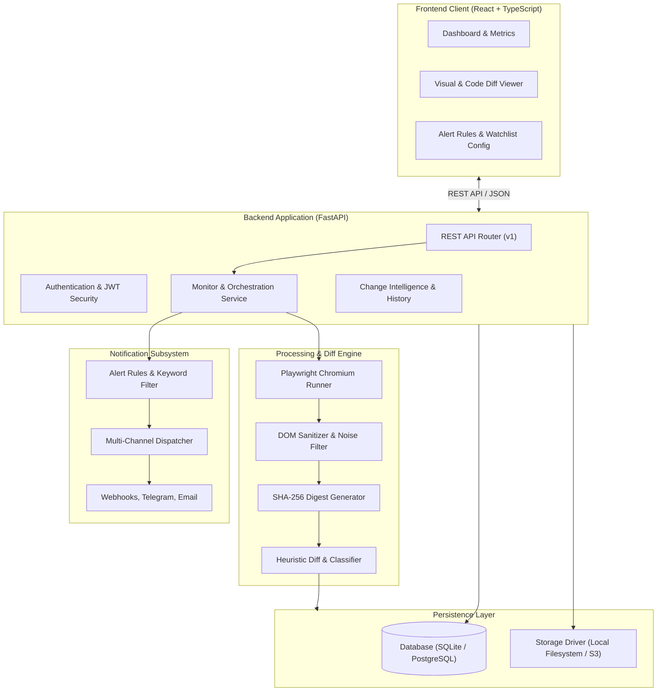

# Website Change Detection Platform

**Live Deployment:** [https://change-detector-production.up.railway.app](https://change-detector-production.up.railway.app)

A production-grade, developer-first website change monitoring and visual regression platform. Designed as a modular monolith providing real-browser DOM rendering, cryptographic content hashing, semantic change classification, visual split-screen comparisons, and alert suppression rules.

---

## Overview

The Website Change Detection Platform monitors web pages for visual, structural, and textual mutations. By utilizing headless Playwright browser automation rather than basic HTTP scrapers, the system handles single-page applications (SPAs), dynamic DOM changes, and client-side JavaScript execution.

Captured snapshots are normalized to eliminate volatile noise (such as dynamic timestamps, cookie banners, and rotating advertisements). Content changes are evaluated against deterministic thresholds, categorized into semantic business impact tiers, and dispatched across configured notification channels.

---

## System Architecture



---

## Core Capabilities

### 1. Real Browser Automation (Playwright)
- Headless Chromium executes client-side JavaScript and waits for network idle or DOMContentLoaded states.
- Captures full-page high-resolution PNG screenshots alongside sanitized DOM text.
- Overcomes bot blocks and dynamic client-side hydration limitations.

### 2. Intelligent DOM Normalization & Noise Filtering
- Strips non-content elements: scripts, styles, iframes, SVG paths, and tracking pixels.
- Automatically handles cookie banners, GDPR consent overlays, and dynamic ad containers.
- Standardizes dynamic session tokens, dates, and visitor counters to prevent false-positive diffs.
- Supports user-defined CSS selectors to monitor or ignore specific DOM subtrees.

### 3. Visual Before/After Comparison Suite
- **Draggable Split Slider:** Interactive split-screen view with a movable divider and dynamic CSS clipping to inspect visual shifts.
- **Synchronized Dual View:** Side-by-side columns presenting baseline and current snapshot images with full-resolution review links.
- **Opacity Blend Overlay:** Adjustable transparency layer (0% to 100%) to instantly highlight micro-layout shifts and CSS regressions.

### 4. Smart Change Intelligence & Semantic Summaries
- **Semantic Classification:** Categorizes detected mutations into business domains:
  - `PRICING_UPDATE` (pricing tables, plan modifications, rate changes)
  - `STOCK_AVAILABILITY` (in-stock, out-of-stock, inventory updates)
  - `POLICY_TERMS` (terms of service, privacy policies, compliance disclosures)
  - `FEATURE_RELEASE` (version announcements, changelogs, release notes)
  - `MAJOR_REDESIGN` (large-scale layout restructuring)
  - `CONTENT_COPY` (standard text and editorial refinements)
- **Severity Ratings:** Dynamically assigned impact levels (`CRITICAL`, `HIGH`, `MEDIUM`, `LOW`).
- **Entity Extraction:** Identifies currency figures, price points, and affected product plans.
- **Executive Summaries:** Generates concise plain-English descriptions of what changed.

### 5. Alert Sensitivity & Keyword Watchlists
- **Threshold Sensitivity:** Configurable minimum change percentage threshold (0.0% to 50.0%) to suppress trivial alerts.
- **Keyword Watchlists:** Restricts notification triggers to high-priority terms (for example: `price`, `CVE`, `discount`, `out of stock`).
- **Downtime Notifications:** Granular option to enable or mute HTTP 4xx/5xx offline alerts.
- **Audit Preservation:** Changes below threshold are recorded in historical logs while suppressing notification delivery.

### 6. Multi-Channel Alert Delivery
- **Discord / Slack Webhooks:** Structured payload dispatch with change metrics and deep links.
- **Telegram Bot:** Real-time messages with severity ratings and executive summaries.
- **SMTP Email:** Clean HTML formatted notifications.
- **Debounce Protection:** Rate-limiting mechanism to avoid alert floods during server flapping.

---

## Technology Stack

### Backend
- **Framework:** FastAPI (Python 3.12+)
- **ORM / Database:** SQLAlchemy 2.0 (AsyncIO), SQLite (default) / PostgreSQL
- **Browser Automation:** Playwright (Chromium)
- **Authentication:** JWT (JSON Web Tokens) with passlib / bcrypt
- **Task Scheduling:** Asynchronous background loop / Celery Beat ready
- **Validation:** Pydantic v2

### Frontend
- **Framework:** React 18 / React 19
- **Build Tool:** Vite
- **Language:** TypeScript
- **Styling:** Tailwind CSS
- **Icons:** Lucide React
- **Data Fetching:** Fetch API with custom client interceptors

---

## Getting Started

### Prerequisites
- Python 3.12 or newer
- Node.js 18 or newer
- npm or yarn

---

### Backend Setup

1. Navigate to the `backend` directory:
   ```bash
   cd backend
   ```

2. Create and activate a Python virtual environment:
   ```bash
   # Windows (PowerShell)
   python -m venv venv
   .\venv\Scripts\Activate.ps1

   # Linux / macOS
   python -m venv venv
   source venv/bin/activate
   ```

3. Install dependencies:
   ```bash
   pip install -r requirements.txt
   ```

4. Install Playwright browser binaries:
   ```bash
   playwright install chromium
   ```

5. Initialize the database and launch the server:
   ```bash
   python run_server.py
   ```
   The backend API will start at `http://127.0.0.1:5000`. Interactive OpenAPI documentation is available at `http://127.0.0.1:5000/docs`.

---

### Frontend Setup

1. Navigate to the `frontend` directory:
   ```bash
   cd frontend
   ```

2. Install dependencies:
   ```bash
   npm install
   ```

3. Start the development server:
   ```bash
   npm run dev -- --port 3001
   ```
   The frontend interface will be accessible at `http://localhost:3001`.

---

## Configuration

Configuration values are managed via environment variables or a `.env` file located in the `backend/` directory:

| Variable | Default Value | Description |
| :--- | :--- | :--- |
| `SECRET_KEY` | `dev_secret_key_change_in_production` | Cryptographic secret for signing JWTs |
| `DATABASE_URL` | `sqlite+aiosqlite:///./change_detector.db` | SQLAlchemy connection URI |
| `STORAGE_DRIVER` | `local` | Storage driver (`local` or `s3`) |
| `LOCAL_STORAGE_DIR` | `./storage_data` | Directory for storing snapshots and screenshots |
| `DEFAULT_CHECK_INTERVAL_MINUTES` | `60` | Default periodic monitoring interval |
| `MAX_CONCURRENT_CHECKS` | `3` | Maximum concurrent Playwright browser sessions |

---

## REST API Summary

### Authentication
- `POST /api/v1/auth/register` - Create user account
- `POST /api/v1/auth/login` - Authenticate and receive Bearer JWT
- `GET /api/v1/auth/me` - Retrieve current user profile

### Monitored Websites
- `GET /api/v1/websites` - List all monitored targets
- `POST /api/v1/websites` - Register a new monitoring target
- `GET /api/v1/websites/{id}` - Retrieve website details, snapshots, and diff history
- `PUT /api/v1/websites/{id}` - Update check intervals, threshold rules, or watchlist
- `DELETE /api/v1/websites/{id}` - Remove a target and its associated data
- `POST /api/v1/websites/{id}/check` - Trigger an immediate manual check
- `POST /api/v1/websites/{id}/simulate-change` - Test diff engine against sandbox mutations

### Changes & Diffs
- `GET /api/v1/changes/recent` - Global stream of detected changes
- `GET /api/v1/changes/{id}` - Detailed change record with unified diff and snapshot paths

### Notification Channels
- `GET /api/v1/notifications/channels` - List configured alert destinations
- `POST /api/v1/notifications/channels` - Add a webhook, Telegram, or email channel
- `POST /api/v1/notifications/channels/{id}/test` - Dispatch a test ping

---

## Testing

Run backend unit and integration tests:

```bash
cd backend
pytest -v
```

Run frontend type checking and production build validation:

```bash
cd frontend
npm run build
```

---

## Project Structure

```text
├── backend/
│   ├── app/
│   │   ├── api/v1/          # Route handlers (auth, websites, changes, notifications)
│   │   ├── core/            # Configuration and security settings
│   │   ├── db/              # Database session and base models
│   │   ├── diff/            # HTML normalization, hashing, and diff heuristics
│   │   ├── models/          # SQLAlchemy ORM entity definitions
│   │   ├── notifications/   # Dispatcher and channel integrations
│   │   ├── schemas/         # Pydantic validation schemas
│   │   ├── scraper/         # Playwright browser runner
│   │   └── services/        # Business logic services
│   ├── tests/               # Backend automated tests
│   └── run_server.py        # Application entrypoint
├── frontend/
│   ├── src/
│   │   ├── api/             # API client and request utilities
│   │   ├── components/      # UI components (diff viewer, navigation, modals)
│   │   ├── features/        # Feature modules (dashboard, websites, settings)
│   │   └── types/           # TypeScript interface definitions
│   ├── package.json
│   └── vite.config.ts
└── README.md
```

---

## License

This project is licensed under the MIT License.
