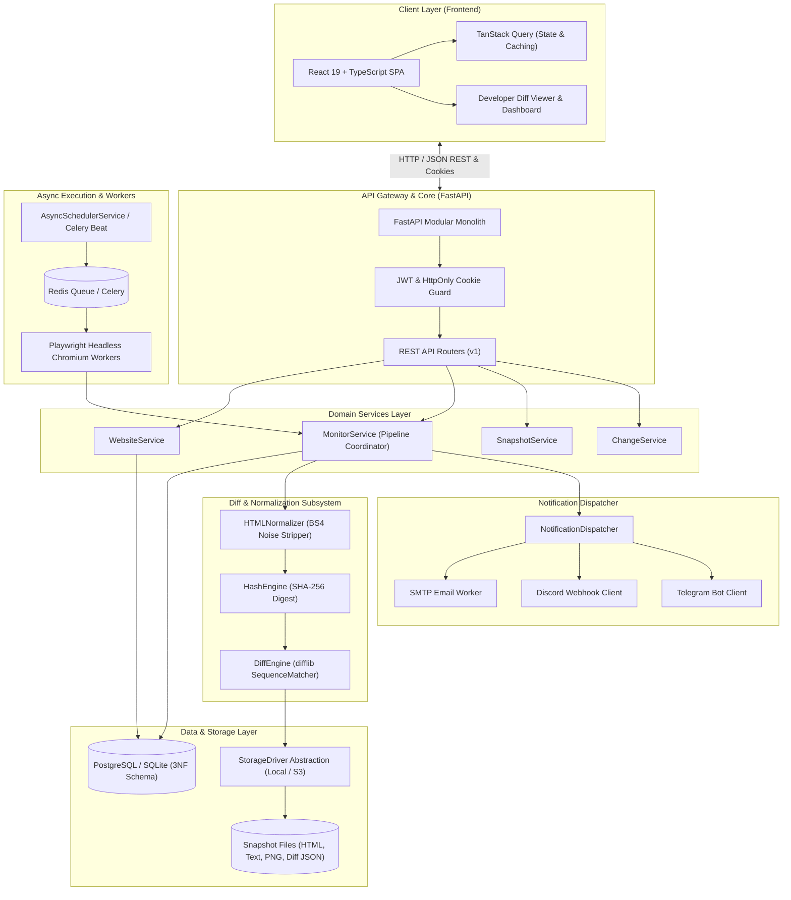
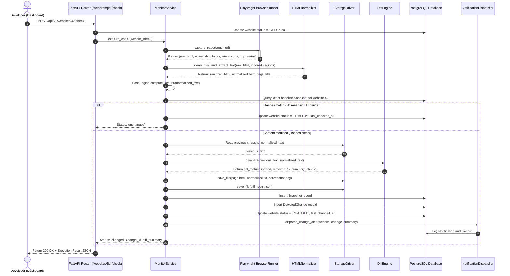
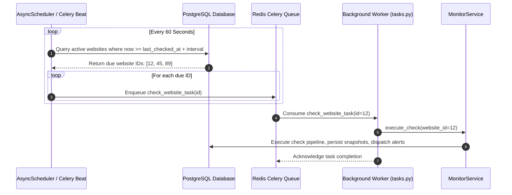

# System Architecture & Design Specification

## Overview

The **Website Change Detection Platform** is engineered as a high-reliability **Modular Monolith**. It avoids the distributed transaction and network hop overhead of microservices while enforcing strict domain separation and clean interface boundaries.

Every module within the monolith possesses a single, well-defined responsibility. The system is designed to continuously monitor public websites, render complex client-side dynamic web applications using headless browser automation, filter out non-semantic noise (timestamps, ads, CSRF tokens), compute deterministic content hashes, calculate fine-grained diffs, and dispatch notifications across multiple channels.

---

## 1. Overall System Architecture Diagram

---

## 2. Sequence Diagram: Website Monitoring Request (On-Demand Check)

---

## 3. Sequence Diagram: Background Scheduled Check

---

## 4. Key Design Decisions

### Modular Monolith over Microservices
1. **Zero RPC Latency:** Communication between `MonitorService`, `DiffEngine`, and `StorageDriver` happens within Python in-memory method calls rather than gRPC/HTTP overhead.
2. **Simplified Atomic Transactions:** Relational integrity across `Website`, `Snapshot`, and `DetectedChange` tables can be managed within standard database transaction blocks (`session.commit()` / `session.rollback()`).
3. **Low Operational Overhead:** The single codebase can run locally as a zero-dependency process using SQLite and in-process background scheduling, while scaling seamlessly in production with PostgreSQL, Celery, and Redis.

### Playwright Headless Automation
- **Real Single-Page Application (SPA) Rendering:** Traditional cURL/HTTP requests fail on modern React/Vue websites because the raw HTML is an empty `

`. Playwright executes JavaScript, waits for `networkidle` or `domcontentloaded`, and captures the true rendered DOM.
- **Visual Proof:** Playwright captures full-page high-resolution PNG screenshots alongside DOM serialization, enabling developers to visually inspect changes side-by-side.

### Deterministic Noise Filtering
- Before content hashing, `HTMLNormalizer` strips volatile non-semantic elements: `<script>`, `<style>`, `<iframe>`, cookie banners, Google Ads containers, ISO timestamps, live view counters, and user-specified CSS selectors.
- This ensures that SHA-256 hashes remain stable and only trigger alerts when human-meaningful content changes.

---

## 5. Interview Explanation Guide

**Q: Why choose a Modular Monolith instead of Microservices?**
> *"For a website change detection system, the primary bottleneck is I/O (browser rendering and network latency), not CPU saturation from inter-service communication. By adopting a Modular Monolith with bounded contexts, we eliminate network failures between services, avoid distributed 2-phase commits, maintain high development velocity, and simplify deployment down to a single container. If scale warrants, each module (e.g. Playwright Worker) can be decoupled into an independent worker service via our existing Celery task queue."*

**Q: How do you prevent false positives from dynamic websites?**
> *"We employ a 3-tier noise reduction pipeline: First, DOM tree sanitization strips all script, style, ad, and cookie banner tags. Second, regex normalization masks dynamic tokens such as timestamps (`[TIMESTAMP]`), session IDs (`[HASH_TOKEN]`), and view counts (`[DYNAMIC_COUNTER]`). Third, users can configure custom CSS selectors to target or exclude specific DOM regions. Only the sanitized textual content is SHA-256 hashed."*
