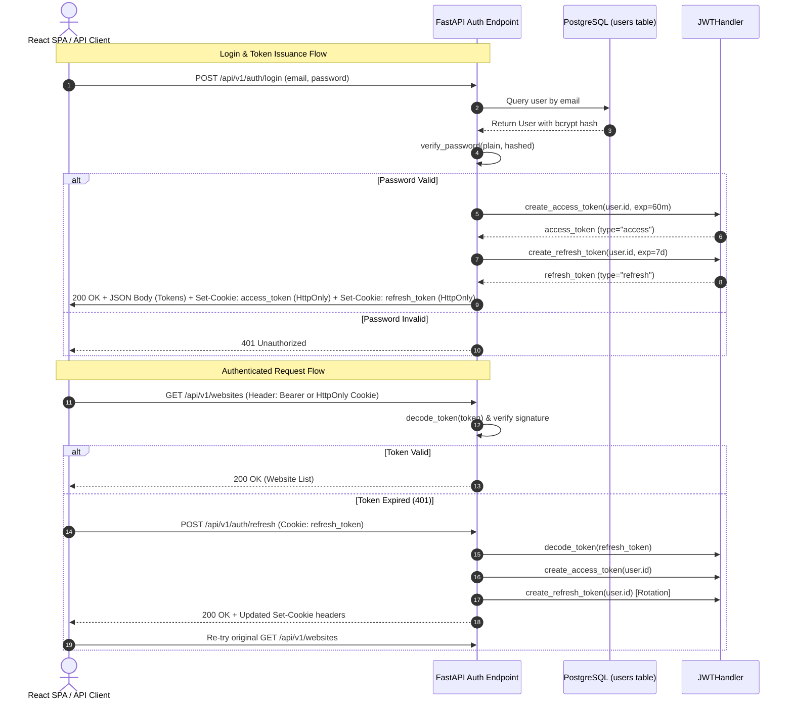

# Authentication & Token Rotation Architecture

## Overview

The **Authentication Subsystem** enforces secure access control across all API routes while supporting two client personas:
1. **Web Browser Single Page Applications (React):** Uses secure, **HttpOnly**, **SameSite=Lax** cookies to protect tokens from Cross-Site Scripting (XSS) extraction.
2. **Programmatic Developers & CLI Scripts:** Uses standard `Authorization: Bearer <access_token>` headers.

The system features **Refresh Token Rotation**, ensuring that compromised refresh tokens cannot be reused indefinitely.

---

## 1. Authentication Flow Diagram

---

## 2. Token Claims & Cryptography

- **Algorithm:** HMAC-SHA256 (`HS256`).
- **Access Token Claims:**
  - `sub`: User ID string (`"42"`).
  - `exp`: Expiration timestamp (default: 60 minutes).
  - `type`: Token type identifier (`"access"`).
- **Refresh Token Claims:**
  - `sub`: User ID string.
  - `exp`: Expiration timestamp (default: 7 days).
  - `type`: Token type identifier (`"refresh"`).

Type validation guarantees that a refresh token cannot be passed to a protected endpoint as an access token.

---

## 3. Refresh Token Rotation

When the client requests a token refresh at `/api/v1/auth/refresh`:
1. The incoming refresh token is verified for signature and expiration.
2. A new access token is created.
3. A **new refresh token** is simultaneously generated and returned.
4. The previous refresh token is discarded.

If a refresh token is stolen by an attacker, once the legitimate user uses their token to refresh, the rotation invalidates subsequent use, terminating the attack window.

---

## 4. Interview Explanation Guide

**Q: Why store tokens in HttpOnly cookies instead of localStorage in the browser?**
> *"Tokens stored in `localStorage` or `sessionStorage` are completely accessible to any JavaScript running on the page. In the event of a third-party dependency compromise or Cross-Site Scripting (XSS) vulnerability, an attacker can extract `localStorage.getItem('token')` and impersonate the user. `HttpOnly` cookies cannot be accessed or read by JavaScript (`document.cookie`), completely neutralising token extraction via XSS."*

**Q: How do you prevent Cross-Site Request Forgery (CSRF) when using cookies?**
> *"We set the `SameSite=Lax` flag on our cookies. This instructs the browser to never send the cookie on cross-site state-modifying requests (like cross-origin `POST`, `PUT`, or `DELETE` requests from foreign websites). Furthermore, our API supports standard `Authorization: Bearer` headers, where foreign sites cannot attach custom headers without preflight CORS approval."*
