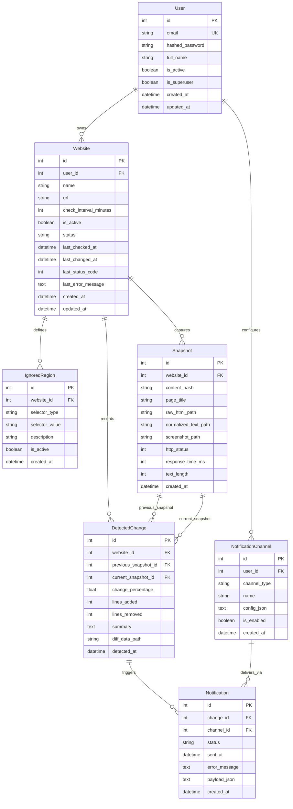

# Database Architecture & Entity Relationship Specification

## Overview

The database layer is modeled following **Third Normal Form (3NF)** standards to eliminate data redundancy, enforce referential integrity, and optimize query latency for timeseries snapshot records and change feeds.

The schema comprises **7 relational tables** managed via **SQLAlchemy 2.0** and version-controlled using **Alembic**.

---

## 1. Entity Relationship (ER) Diagram

---

## 2. Table Schemas & Normalization Analysis

### 1. `users`
- **Purpose:** Stores authenticated user accounts and credential hashes.
- **Normalization:** 1NF (atomic attributes), 2NF (all columns depend on PK `id`), 3NF (no transitive dependencies).
- **Key Columns:** `id` (PK), `email` (Unique Index), `hashed_password` (Bcrypt), `is_active`, `is_superuser`.

### 2. `websites`
- **Purpose:** Represents target URLs monitored by the platform.
- **Foreign Key:** `user_id` $\rightarrow$ `users.id` (`ON DELETE CASCADE`).
- **Key Columns:** `url`, `check_interval_minutes`, `status` (`HEALTHY`, `CHANGED`, `FAILED`, `CHECKING`, `PENDING`), `last_checked_at`, `last_changed_at`.
- **Indexing:** Indexes on `user_id`, `url`, `status`, and `is_active` enable rapid scheduling evaluation queries.

### 3. `ignored_regions`
- **Purpose:** Stores user-configured dynamic noise exclusion rules.
- **Foreign Key:** `website_id` $\rightarrow$ `websites.id` (`ON DELETE CASCADE`).
- **Key Columns:** `selector_type` (`css`, `xpath`, `tag`), `selector_value` (`.live-counter`, `footer .time`), `is_active`.

### 4. `snapshots`
- **Purpose:** Immutable audit point capturing website content state at a specific timestamp.
- **Foreign Key:** `website_id` $\rightarrow$ `websites.id` (`ON DELETE CASCADE`).
- **Storage Decoupling:** Instead of storing multi-megabyte HTML strings and binary PNG screenshots directly in the database row (which bloats Postgres buffer caches), the record stores relative storage URIs (`raw_html_path`, `normalized_text_path`, `screenshot_path`).
- **Key Columns:** `content_hash` (Indexed SHA-256 string), `response_time_ms`, `http_status`, `created_at`.

### 5. `detected_changes`
- **Purpose:** Records computed diff metrics between two snapshots.
- **Foreign Keys:**
  - `website_id` $\rightarrow$ `websites.id` (`ON DELETE CASCADE`)
  - `previous_snapshot_id` $\rightarrow$ `snapshots.id` (`ON DELETE SET NULL`)
  - `current_snapshot_id` $\rightarrow$ `snapshots.id` (`ON DELETE CASCADE`)
- **Key Columns:** `change_percentage`, `lines_added`, `lines_removed`, `summary`, `diff_data_path`.

### 6. `notification_channels`
- **Purpose:** Stores user destinations for alerts (Discord, Email, Telegram).
- **Foreign Key:** `user_id` $\rightarrow$ `users.id` (`ON DELETE CASCADE`).
- **Key Columns:** `channel_type`, `name`, `config_json` (JSON blob containing webhook URLs, bot tokens, or email addresses).

### 7. `notifications`
- **Purpose:** Log of dispatched alerts for auditing, retrying, and deliverability verification.
- **Foreign Keys:**
  - `change_id` $\rightarrow$ `detected_changes.id` (`ON DELETE CASCADE`)
  - `channel_id` $\rightarrow$ `notification_channels.id` (`ON DELETE CASCADE`)
- **Key Columns:** `status` (`SENT`, `FAILED`, `PENDING`), `sent_at`, `error_message`.

---

## 3. Indexing Strategy

1. **`users(email)` (UNIQUE):** $O(1)$ lookup during authentication and JWT resolution.
2. **`websites(is_active, last_checked_at)` (COMPOSITE):** Fast lookup for periodic scheduler beat query (`SELECT * FROM websites WHERE is_active = true AND (last_checked_at IS NULL OR now() >= last_checked_at + interval)`).
3. **`snapshots(website_id, created_at DESC)`:** Instant retrieval of the latest baseline snapshot for comparison.
4. **`snapshots(content_hash)`:** Rapid lookup for identical snapshot deduplication.
5. **`detected_changes(website_id, detected_at DESC)`:** Rapid retrieval for website change timeline feeds.

---

## 4. Interview Explanation Guide

**Q: Why store storage paths instead of raw HTML and screenshot blobs in the database?**
> *"Database rows should remain lightweight to maximize cache hit rates in PostgreSQL shared buffers. Storing large text or binary BLOBs inside rows causes table bloat, slows sequential scans, and balloons database backup size. By adhering to the Pointer Pattern (persisting large payloads via our StorageDriver and storing only relative keys in PostgreSQL), our database operations remain ultra-fast and scale horizontally to millions of snapshots."*

**Q: How does the schema guarantee snapshot deduplication?**
> *"Every snapshot computes a deterministic SHA-256 hash of the normalized, noise-filtered text. Before persisting a new snapshot, the MonitorService queries the latest snapshot record for the website. If the hashes match, no new Snapshot row or file is created, conserving storage while updating health metrics."*
