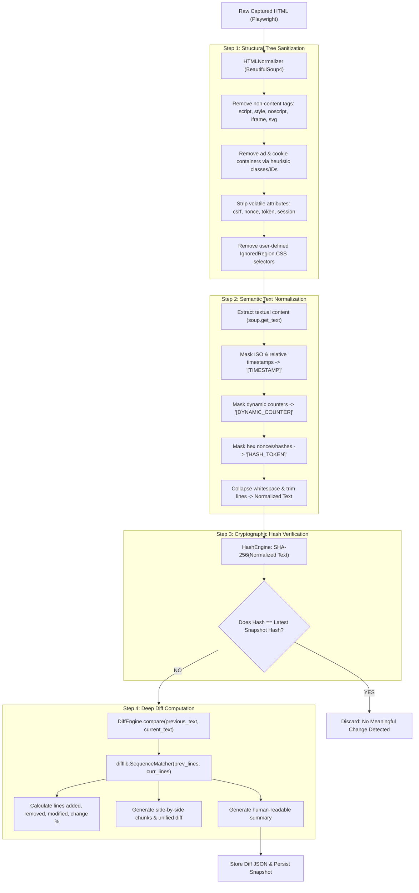

# Diff Engine & Semantic Noise Filtering Architecture

## Overview

The **Diff Engine** is the core analytical component of the platform. Its objective is to distinguish between **meaningful content changes** (e.g. price drops, policy updates, headline edits) and **ephemeral dynamic noise** (e.g. timestamps, ad rotations, CSRF tokens, visitor counters).

Without sophisticated normalization, naive diffing triggers dozens of false positive alerts every hour on modern websites.

---

## 1. Diff Engine & Noise Filtering Flow

---

## 2. Noise Filtering Strategies

### 1. Element Tag Removal
Tags that do not contribute to visual text are stripped immediately: `<script>`, `<style>`, `<noscript>`, `<iframe>`, `<svg>`, `<canvas>`, `<embed>`, `<object>`.

### 2. Common Ad & Privacy Containers
Heuristic regex patterns match and decompose common third-party overlays:
- Cookie banners: `cookie[-_]?(banner|consent|modal|notice|popup)`
- GDPR notices: `gdpr[-_]?(banner|consent|modal|notice)`
- Advertisements: `ad[-_]?(container|wrapper|banner|slot|unit)`, `adsbygoogle`
- Live widgets: `live[-_]?(chat|counter|views|visitors)`

### 3. Dynamic Text Token Masking
- **Dates & Times:** Replaces strings like `2026-10-15 14:00`, `Oct 15, 2026`, `5 minutes ago`, `just now`, `12:45 PM` with the static placeholder `[TIMESTAMP]`.
- **Session Tokens:** Replaces random hex nonces matching `\b[a-f0-9]{32,64}\b` with `[HASH_TOKEN]`.
- **Dynamic Counters:** Replaces strings like `1,420 views`, `45 users online`, `3 items in cart` with `[DYNAMIC_COUNTER]`.

### 4. User-Configured CSS Selectors
Users can inspect their monitored website in browser devtools and add custom CSS selectors (e.g. `#stock-ticker`, `.trending-bar`, `footer .uptime`) to exclude specific volatile elements from comparison.

---

## 3. Diff Engine Implementation

Located in `app/diff/diff_engine.py`:
- Uses Python's standard `difflib.SequenceMatcher` to find matching blocks between previous lines and current lines.
- Computes:
  - `similarity_ratio` $\in [0.0, 1.0]$
  - `change_percentage` $= \text{round}((1.0 - \text{similarity\_ratio}) \times 100.0, 2)$
  - `lines_added` and `lines_removed`
  - `lines_modified`
  - `unified_diff`: Standard Git-compatible patch string.
  - `chunks`: Structured JSON array with line numbers and line content for side-by-side rendering in the React frontend.
  - `summary`: Context-aware explanation (e.g. *"Content changed by 12.4% (+3 lines added, -1 lines removed). Affected: 'Price: $29/mo...' "*).

---

## 4. Interview Explanation Guide

**Q: How do you measure the degree of content mutation between two versions?**
> *"We utilize Ratcliff-Obershelp pattern matching implemented via Python's `difflib.SequenceMatcher`. It finds the longest contiguous common sequence of lines, recursively matches the remaining sequences, and produces a similarity ratio $R = \frac{2M}{T}$ where $M$ is the count of matches and $T$ is the total elements in both versions. The mutation percentage is defined as $(1.0 - R) \times 100$. This metric gives developers a quantifiable index of change severity."*

**Q: Why separate the hash check from the diff calculation?**
> *"Calculating a full line-by-line diff on multi-megabyte text strings is computationally intensive ($O(N \cdot M)$ in worst case). Hashing via SHA-256 is $O(N)$ and allows an instant $O(1)$ equality check against the database index. If the hashes match, we exit immediately without invoking the DiffEngine, reducing CPU overhead by orders of magnitude."*
