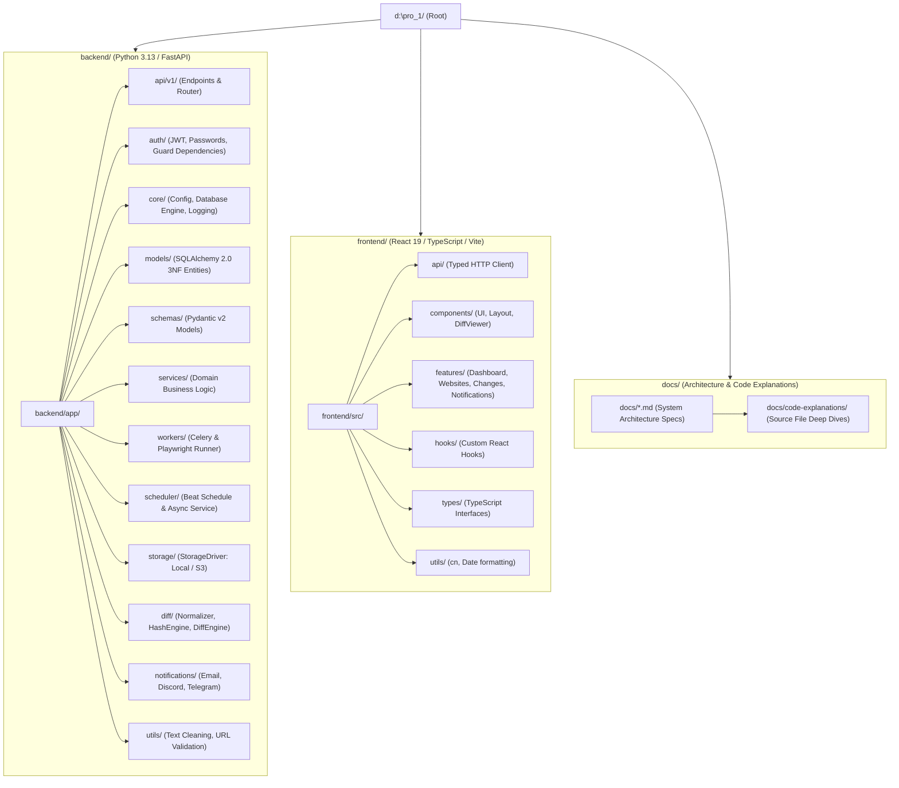

# Folder Structure & Modular Monolith Layout

## Overview

The directory layout adheres to strict Modular Monolith architectural principles. The codebase maintains clear separation between **domain models**, **business logic services**, **worker execution**, **storage drivers**, and **client presentation**.

---

## 1. Project Directory Tree

---

## 2. Module Boundary Responsibilities

| Directory | Layer | Single Responsibility |
| :--- | :--- | :--- |
| `backend/app/api/v1/` | Presentation (HTTP) | Request validation, status code mapping, HTTP response serialization |
| `backend/app/auth/` | Cross-Cutting Security | Password hashing, JWT signing/decoding, HttpOnly cookie injection |
| `backend/app/core/` | Infrastructure Core | Pydantic Settings, Async SQLAlchemy Engine, Structured Logging |
| `backend/app/models/` | Data Persistence | 3NF relational database schema definitions |
| `backend/app/schemas/` | Data Contract | Input/output validation and typed serialization contracts |
| `backend/app/services/` | Domain Logic | Business rules orchestration (`MonitorService`, `WebsiteService`) |
| `backend/app/diff/` | Domain Computation | BeautifulSoup noise filtering, SHA-256 hashing, SequenceMatcher diffs |
| `backend/app/workers/` | Execution Pool | Playwright Chromium automation, Celery worker task definitions |
| `backend/app/scheduler/`| Automation Timing | Periodic tick evaluation, interval matching, task queuing |
| `backend/app/storage/` | Infrastructure I/O | Abstract filesystem and object storage drivers (Local / S3) |
| `backend/app/notifications/` | External Dispatch | Email, Discord Webhook, and Telegram Bot alert dispatchers |
| `frontend/src/features/`| UI Views | Domain-centric views (Dashboard, Monitors, Diff Inspector, Alerts) |
| `frontend/src/components/`| UI Reusability | Atomic developer components (Buttons, Badges, Modals, DiffViewer) |

---

## 3. Interview Explanation Guide

**Q: Why avoid generic 'utils' dumping grounds?**
> *"A common anti-pattern in large codebases is a massive `helpers.py` or `utils.py` file containing hundreds of unrelated functions. In our architecture, every utility belongs strictly to its domain: HTML sanitization belongs in `app/diff/normalizer.py`, password hashing belongs in `app/auth/security.py`, and token generation belongs in `app/auth/jwt_handler.py`. Only truly domain-agnostic helpers (like string cleaning) live in `app/utils/`. This preserves high cohesion and low coupling."*
