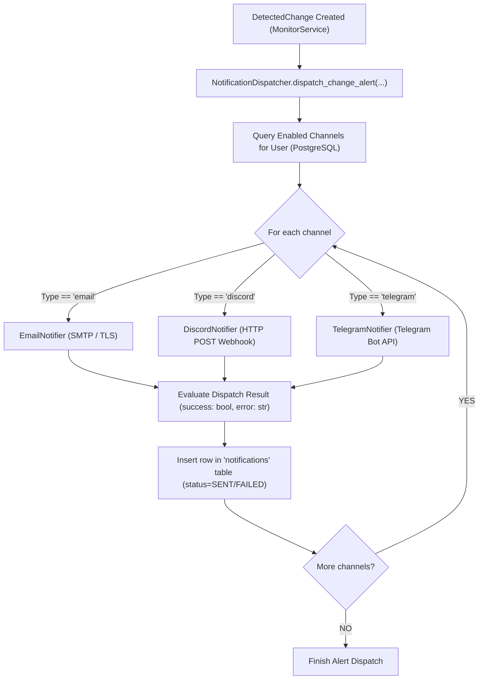

# Notification Subsystem & Dispatcher Architecture

## Overview

The **Notification Subsystem** alerts developers and operations teams immediately when meaningful website changes are detected.

It supports multiple channel integrations:
1. **SMTP Email:** Plaintext and clean, responsive HTML email alerts.
2. **Discord Webhooks:** Rich visual embed cards with metrics, color codes, and dashboard links.
3. **Telegram Bot:** Real-time Markdown messages via the official Telegram Bot API.

Every dispatch attempt is audited and persisted in the `notifications` table to track deliverability and retry failures.

---

## 1. Notification Dispatch Flow



---

## 2. Channel Configurations

### Discord Webhook
- **Protocol:** HTTPS POST via `httpx.AsyncClient`.
- **Payload Structure:** Discord Embed Card with title, website URL, change summary, metrics fields (Lines Added, Removed, Change %), and color coding (Amber for small/medium changes, Orange/Red for large changes).
- **Latency:** ~250ms per alert.

### Telegram Bot API
- **Protocol:** HTTPS POST to `https://api.telegram.org/bot<token>/sendMessage`.
- **Format:** Markdown text with bold title, linked target URL, and structured change percentage badges.

### SMTP Email
- **Protocol:** Standard SMTP with `STARTTLS` on port 587 or 465.
- **Async Execution:** Heavy socket network operations run in an asynchronous worker thread pool using `anyio.to_thread.run_sync`.
- **Content:** Multipart MIME structure with both plain text and styled HTML.

---

## 3. Audit Logging & Reliability

Every attempted delivery creates an immutable record in the `notifications` table:
```sql
CREATE TABLE notifications (
    id SERIAL PRIMARY KEY,
    change_id INT REFERENCES detected_changes(id) ON DELETE CASCADE,
    channel_id INT REFERENCES notification_channels(id) ON DELETE CASCADE,
    status VARCHAR(20) NOT NULL, -- 'SENT', 'FAILED', 'PENDING'
    sent_at TIMESTAMP WITH TIME ZONE,
    error_message TEXT,
    payload_json TEXT,
    created_at TIMESTAMP WITH TIME ZONE DEFAULT CURRENT_TIMESTAMP
);
```
If a webhook returns a 429 Rate Limit or 5xx Server Error, the error string is captured in `error_message` for diagnostic analysis in the dashboard.

---

## 4. Interview Explanation Guide

**Q: Why decouple notification dispatch from the website check request?**
> *"Website checks run under strict timeout envelopes (e.g. 30 seconds). Third-party notification endpoints (like an overloaded Discord webhook or a sluggish SMTP mail server) can introduce several seconds of latency or fail intermittently. Decoupling notification dispatch via asynchronous coroutines or background tasks ensures that snapshot persistence is never blocked by an external notification provider's downtime."*
