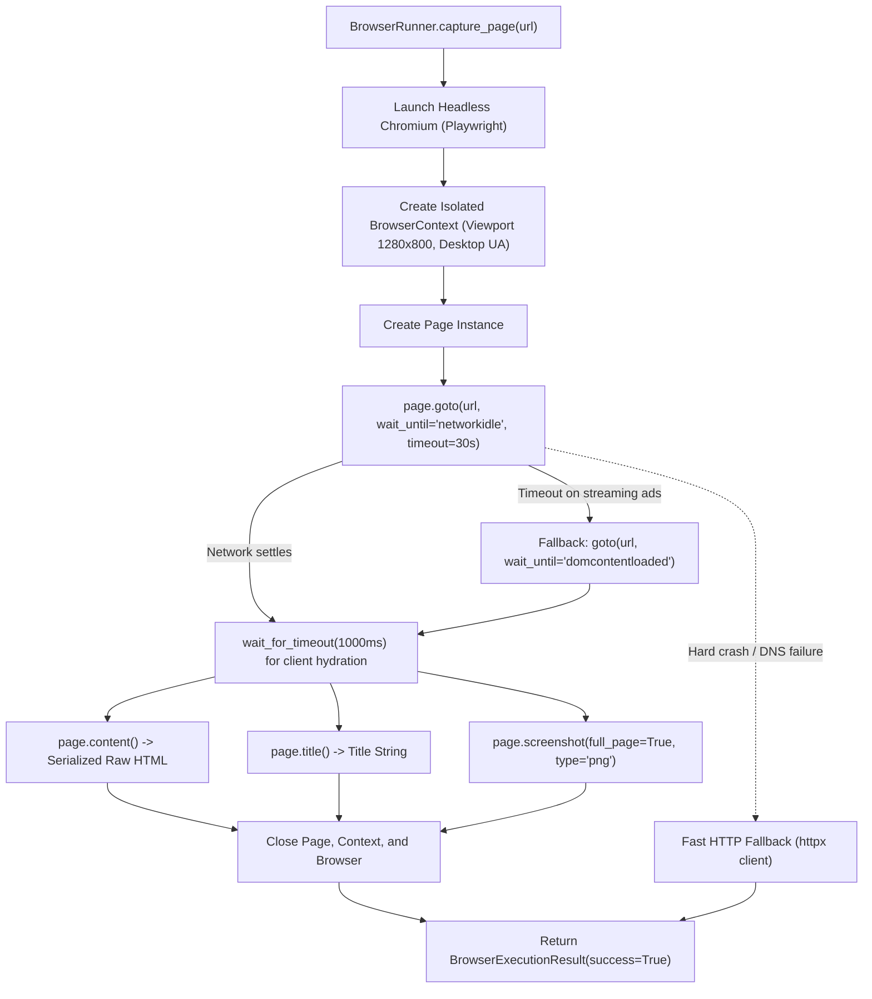

# Browser Automation Architecture (Playwright)

## Overview

Modern web pages are dynamic Single Page Applications (SPAs) built with React, Vue, Next.js, or Angular. Standard HTTP client libraries (like `requests` or `urllib`) only download the initial server response—typically an empty HTML shell with `

`—failing to capture dynamically rendered text, pricing tables, or client-hydrated elements.

The **Browser Automation Module** uses **Playwright** with headless **Chromium** to render pages in a real browser environment, execute client-side JavaScript, wait for network quiescence, serialize the true DOM, and capture visual proof via screenshots.

---

## 1. Playwright Architecture & Execution Flow

---

## 2. Key Responsibilities

1. **JavaScript & Hydration Execution:** Renders client-side rendered websites completely.
2. **Dynamic Network Synchronization:** Handles network idle detection with graceful fallback to DOMContentLoaded when third-party trackers or streaming ads keep connections alive.
3. **High-Resolution Full-Page Screenshots:** Captures full scrollable height PNG images for visual change inspection in the dashboard.
4. **Environment Isolation & Sandboxing:** Runs each check in a dedicated `BrowserContext` with fresh cookies and storage, preventing cross-website state leakage.
5. **Fail-Safe HTTP Fallback:** If browser binaries encounter unexpected host OS sandbox constraints, the runner automatically falls back to an asynchronous `httpx` HTTP client to maintain system availability.

---

## 3. Important Design Decisions

### Headless Chromium Flags
The browser is launched with performance and stability flags:
- `--no-sandbox`: Required for containerized execution inside Docker and Linux VPS without root desktop permissions.
- `--disable-dev-shm-usage`: Forces Chromium to use `/tmp` rather than `/dev/shm`, preventing out-of-memory crashes on cloud containers with small shared memory partitions.
- `--disable-gpu`: Disables hardware acceleration for lightweight server-side rendering.

### Isolated BrowserContext vs Browser Process
Launching an entire browser process for every request is expensive (~1.5s overhead). In Playwright, a single browser instance can spawn lightweight, ephemeral `BrowserContext` instances in milliseconds. Contexts provide 100% isolation of cookies, cache, and local storage without the overhead of restarting the underlying browser process.

---

## 4. Interview Explanation Guide

**Q: Why use Playwright over Puppeteer or Selenium?**
> *"Playwright is built by the ex-Puppeteer engineering team at Microsoft and is designed specifically for modern asynchronous web automation. Unlike Selenium, which relies on the legacy JSON wire protocol with high latency and flaky polling, Playwright communicates directly with Chrome DevTools Protocol (CDP) via asynchronous WebSockets. It provides native auto-waiting for elements, robust network idle detection, cross-platform Chromium/WebKit/Firefox support, and first-class async Python bindings (`async_playwright`)."*

**Q: What happens if a website has infinite streaming connections that never trigger 'networkidle'?**
> *"Our runner wraps `page.goto(url, wait_until='networkidle')` in an exception block. If third-party websockets, video streams, or ad networks prevent networkidle from resolving within the configured timeout, the runner catches the timeout and immediately falls back to `wait_until='domcontentloaded'`, followed by a fixed 1,000ms hydration grace period. This guarantees that checks never hang indefinitely."*
