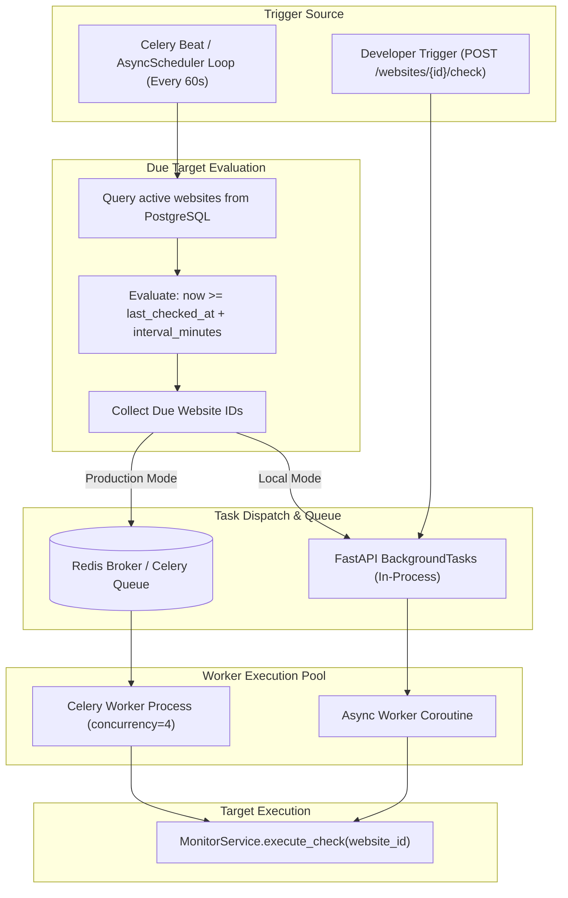

# Background Scheduling & Task Execution Architecture

## Overview

A robust website change detection platform requires an autonomous scheduling engine to trigger checks at user-configured frequencies (e.g. every 5 minutes, 15 minutes, 1 hour, or daily).

The platform implements a **dual scheduling strategy**:
1. **Production Engine:** Distributed **Celery Beat** with **Redis** broker for horizontal scalability.
2. **Local / Self-Contained Engine:** In-process **AsyncSchedulerService** running within the FastAPI event loop for zero-dependency local development and evaluation.

---

## 1. Scheduler Flow Diagram

---

## 2. Responsibilities

- **Periodic Polling:** Ticks every 60 seconds to scan active monitors in the database.
- **Interval Calculations:** Compares current UTC time against `last_checked_at + check_interval_minutes`.
- **Concurrency & Rate Limiting:** Prevents task starvation by decoupling scheduling evaluation from heavy browser rendering tasks.
- **Failure Isolation:** An individual target timeout or browser crash does not disrupt subsequent scheduled jobs.

---

## 3. Celery Tasks Definition

### `check_website_task(website_id: int)`
- Located in `app.workers.tasks`.
- Executes single website check.
- Equipped with retry policy: `max_retries=3`, `default_retry_delay=60s`.

### `check_due_websites_task()`
- Periodic task scheduled by Celery Beat every 60 seconds.
- Queries all active websites from database, calculates intervals, and enqueues individual `check_website_task` jobs.

---

## 4. Interview Explanation Guide

**Q: How do you prevent the 'thundering herd' problem when thousands of websites are scheduled for the same interval?**
> *"We apply three techniques: First, the scheduler operates on a continuous 60-second sliding tick window rather than waiting for discrete hour marks. Second, jobs are enqueued into a Redis queue with prefetch limits (`worker_prefetch_multiplier=1`), ensuring worker processes pull tasks only when they have capacity. Third, future enhancements introduce jitter (e.g., adding a random $\pm 30$ second offset to `check_interval_minutes`) to flatten check distribution across the entire hour."*
