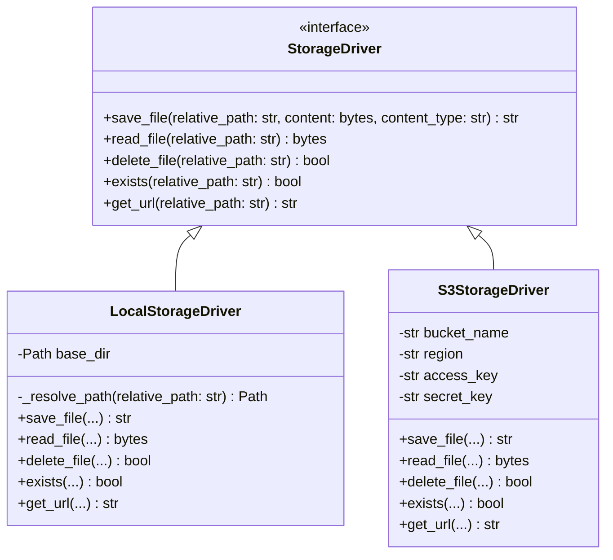

# Storage Subsystem & Asset Persistence Architecture

## Overview

The **Storage Subsystem** manages the persistence and retrieval of unstructured artifacts generated during website monitoring:
1. **Raw Sanitized HTML** (`page.html`)
2. **Normalized Semantic Text** (`normalized.txt`)
3. **Full-Page PNG Screenshots** (`screenshot.png`)
4. **Structured JSON Diff Payloads** (`diff.json`)

To prevent database bloat and ensure seamless migration from single-node local development to multi-node cloud infrastructure, the storage layer implements the **Strategy Pattern** via the abstract `StorageDriver` interface.

---

## 1. StorageDriver Interface & Implementations



---

## 2. Directory & Asset Hierarchy

All snapshot assets are organized deterministically by website ID and unique snapshot token:

```
storage_data/
└── websites/
    ├── {website_id}/
    │   ├── snapshots/
    │   │   └── {snapshot_token}/
    │   │       ├── page.html        # Sanitized DOM content
    │   │       ├── normalized.txt   # Normalized semantic text
    │   │       └── screenshot.png   # Full-page screenshot capture
    │   └── changes/
    │       └── {snapshot_id}_diff.json # Structured diff opcodes & chunks
```

---

## 3. Security: Preventing Path Traversal Attacks

In `LocalStorageDriver`:
- All user-supplied or database relative paths are resolved against the absolute `settings.LOCAL_STORAGE_DIR`.
- The resolved path is verified to ensure it strictly starts with the base directory:
  ```python
  target_path = (self.base_dir / clean_rel).resolve()
  if not str(target_path).startswith(str(self.base_dir)):
      raise ValueError(f"Path traversal detected: {relative_path}")
  ```
- This completely mitigates `../` path traversal vulnerabilities.

---

## 4. Migration to S3 / Cloudflare R2 / MinIO

Migrating from local storage to S3 requires **zero code changes**:
1. Configure environment variables in `.env`:
   ```env
   STORAGE_DRIVER=s3
   S3_BUCKET_NAME=my-change-detector-bucket
   S3_REGION=us-east-1
   S3_ACCESS_KEY=AKIA...
   S3_SECRET_KEY=wJalr...
   ```
2. The singleton factory `get_storage_driver()` in `app/storage/__init__.py` detects `STORAGE_DRIVER=s3` and instantiates `S3StorageDriver`.
3. Application services (`MonitorService`, `SnapshotService`) call the same interface without modification.

---

## 5. Interview Explanation Guide

**Q: How does this storage architecture enable horizontal scalability?**
> *"By abstracting storage behind `StorageDriver`, the application decouples worker compute from stateful disk. When running on multiple nodes or serverless containers, multiple Celery workers can write snapshots to a shared S3/Cloudflare R2 bucket while FastAPI instances read and serve those assets via pre-signed URLs or proxy endpoints. No local shared NFS volumes or complex volume mounts are required."*
