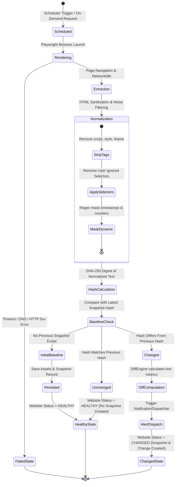

# Website Monitoring & Snapshot Lifecycle Workflow

## Overview

The core lifecycle of the **Website Change Detection Platform** guarantees that monitored websites are captured deterministically, filtered of ephemeral dynamic noise, compared cryptographically, and versioned only when meaningful content changes occur.

---

## 1. Snapshot Lifecycle State Machine

---

## 2. Detailed Pipeline Stages

### Stage 1: Browser Navigation & Client Rendering
1. Target website URL is received from either Celery Beat or manual API trigger.
2. Monitor status transitions to `CHECKING`.
3. Playwright Chromium launches with custom desktop viewport (`1280x800`) and modern user-agent string.
4. Navigation begins with `wait_until="networkidle"`. If long-running ads or streaming connections exceed network idle thresholds, the runner automatically falls back to `wait_until="domcontentloaded"`.
5. Page captures serialized raw HTML, title, response duration, and a full-page PNG screenshot.

### Stage 2: Noise Filtering & Normalization
1. **DOM Cleaning:** BeautifulSoup strips all `<script>`, `<style>`, `<noscript>`, `<iframe>`, `<svg>`, and `<canvas>` nodes.
2. **Ad & Cookie Containers:** Generic heuristic patterns remove elements with classes or IDs matching `cookie-banner`, `consent-modal`, `advertisement`, `adsbygoogle`, and `live-counter`.
3. **Dynamic Attribute Stripping:** Ephemeral CSRF tokens, session IDs, and React root IDs are cleared from attributes.
4. **User-Defined Ignored Regions:** Custom CSS selectors configured by the user are matched and decomposed from the DOM.
5. **Regex Token Masking:** Timestamps (e.g. `2026-10-15 14:00`, `5 minutes ago`) are replaced with `[TIMESTAMP]`, session nonces with `[HASH_TOKEN]`, and live counters with `[DYNAMIC_COUNTER]`.
6. Lines are trimmed and empty lines collapsed.

### Stage 3: Deterministic Cryptographic Hashing
- The sanitized text string is encoded into UTF-8 and hashed via SHA-256.
- The resulting 64-character hexadecimal digest serves as the unique content signature.

### Stage 4: Version Comparison & Diff Calculation
- If no previous snapshot exists for the target website, the current capture is stored as the initial baseline.
- If a previous snapshot exists:
  - If `latest_snapshot.content_hash == current_hash`: **Content is unchanged.** No new snapshot row or file is created, preventing redundant database growth.
  - If `latest_snapshot.content_hash != current_hash`: **Meaningful change detected.**
    - Previous normalized text is loaded from `StorageDriver`.
    - `DiffEngine` executes Python `difflib.SequenceMatcher` to compute unified diff, added/removed line counts, percentage mutated, and structured side-by-side comparison chunks.
    - Assets (`page.html`, `normalized.txt`, `screenshot.png`, `diff.json`) are stored.
    - `Snapshot` and `DetectedChange` rows are committed.

### Stage 5: Alert Dispatching
- `NotificationDispatcher` queries all active channels owned by the user.
- Alerts are dispatched concurrently to Email, Discord webhooks, and Telegram bots.
- Delivery status and diagnostic error messages are logged into `notifications` audit table.

---

## 3. Interview Explanation Guide

**Q: Why do you avoid saving snapshots on every check interval?**
> *"A monitoring tool checking 1,000 websites every 5 minutes produces 288,000 checks per day. If a snapshot was stored on every check, storage and database index sizes would balloon exponentially with 99.9% redundant duplicate data. By enforcing our deterministic hash comparison step, we only persist snapshots when a verified semantic mutation occurs. This saves over 99% of storage and bandwidth while maintaining complete historical version fidelity."*
